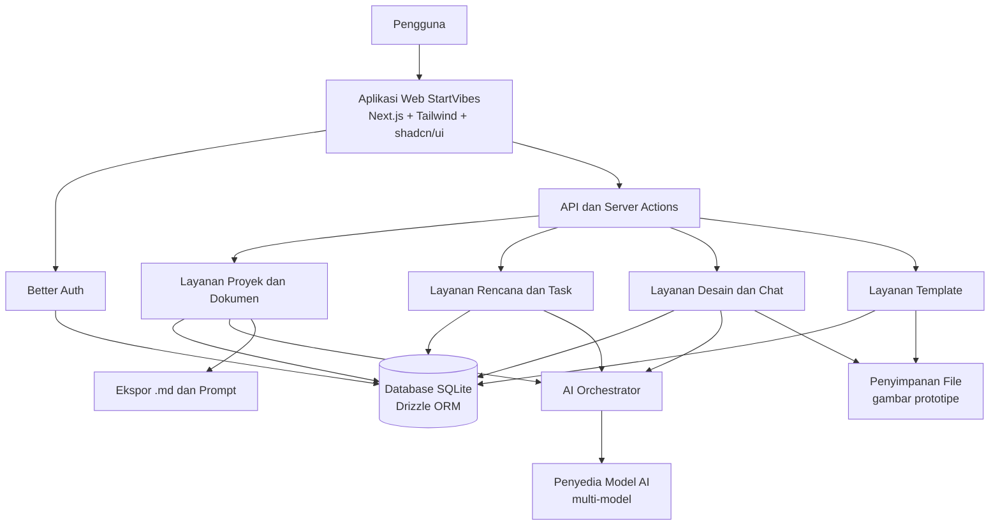
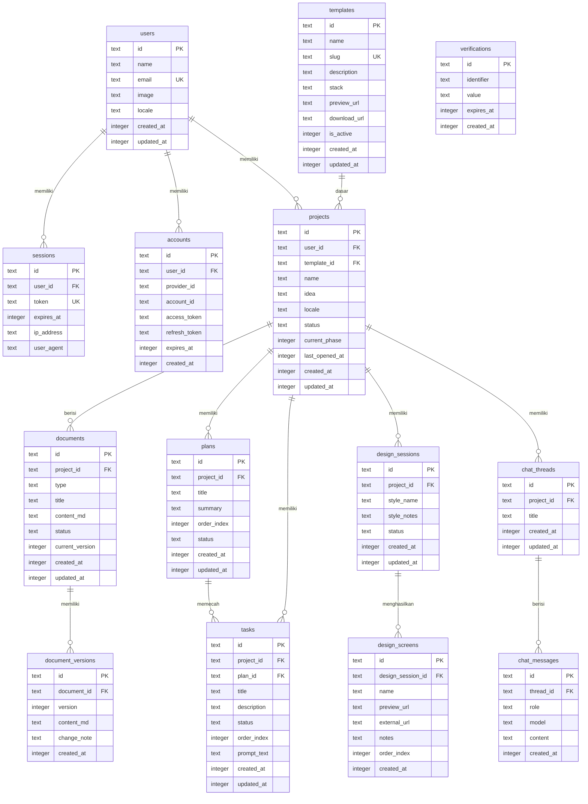

# PRD — Project Requirements Document

## 1. Overview

StartVibes adalah workspace AI untuk membantu orang mengubah ide aplikasi menjadi dokumen proyek yang rapi, terstruktur, dan siap dieksekusi oleh AI coding agent mana pun. Referensi utamanya adalah NgodingPakeAI, tetapi StartVibes memiliki identitas dan positioning sendiri: **membuat alur pembuatan SaaS jadi lebih mudah, aman, dan tidak bikin pusing**.

Masalah utama yang diselesaikan:
- Banyak founder non-teknis, freelancer, agency, dan pemula punya ide aplikasi tetapi bingung menyusun PRD, spesifikasi, rencana, dan task yang benar.
- Hasil bantuan AI sering berantakan, tidak konsisten, atau menjadi **AI slop** yang sulit dipakai.
- Pengguna kesulitan memberikan konteks proyek ke AI coding agent, sehingga hasil build sering meleset, tombol malfungsi, atau alur aplikasi tidak sesuai.
- Dokumen proyek tersebar dan tidak tersimpan rapi, sehingga sulit dilanjutkan kembali.

Tujuan utama StartVibes:
- Menjadi tempat pertama yang dipakai pengguna saat ingin mengubah ide menjadi PRD siap pakai.
- Menghasilkan file `.md` dan prompt siap tempel yang bisa langsung diberikan ke AI agent apa pun.
- Menyediakan alur lengkap dari ide, dokumen proyek, rencana, task, desain tampilan, diskusi multi-model, sampai template codebase.
- Membuat pengalaman yang jelas dan anti-malfungsi: setiap tombol, status, dan langkah memiliki hasil yang dapat diprediksi.
- Menyimpan hasil kerja dengan rapi agar pengguna mudah kembali dan melanjutkan proyek.

## 2. Requirements

Persyaratan utama proyek:

1. **Alur terpandu dari ide ke PRD**
   - Pengguna cukup menulis ide dengan bahasa sehari-hari.
   - AI memandu lewat pertanyaan penting agar PRD lengkap.
   - PRD dihasilkan otomatis, dapat disunting, dan dapat disetujui.

2. **Dokumen proyek siap pakai**
   - StartVibes menghasilkan dokumen `.md` seperti PRD, Agent, Plan, Task, Design, dan Spec.
   - Dokumen dapat dipratinjau, diunduh, disalin sebagai prompt, dan memiliki riwayat versi.

3. **Rencana dan task yang actionable**
   - PRD dapat dipecah menjadi rencana bertahap, daftar task berurutan, rincian spesifikasi, dan prompt siap tempel.

4. **Desain tampilan berbantuan AI**
   - Pengguna dapat memilih gaya tampilan, membuat prototipe layar, merevisi lewat obrolan, dan melanjutkan ke Pen.dev atau mengunduh hasil.

5. **Diskusi multi-model**
   - Pengguna dapat memilih model AI, berdiskusi dengan konteks proyek, membandingkan jawaban, dan menyimpan hasil terbaik ke dokumen.

6. **Template codebase**
   - Tersedia template yang dapat dipilih, dipratinjau, diunduh, dan dilengkapi panduan pemasangan.
   - Template harus membantu mengurangi token terbuang dan mengurangi risiko kerusakan saat dikembangkan.

7. **Akun dan proyek tersimpan**
   - Pengguna dapat daftar/masuk, melihat daftar proyek, dan melanjutkan proyek terakhir.

8. **Bahasa dan wilayah**
   - Mendukung lima bahasa: Inggris, Indonesia, Mandarin, Arab, dan Melayu.
   - Bahasa dapat dipilih manual atau ditebak otomatis dari negara pengguna.
   - Dokumen proyek dapat disajikan dalam bahasa pilihan.

9. **Kualitas pengalaman**
   - Tidak boleh ada tombol mati, alur buntu, atau status yang membingungkan.
   - Setiap proses AI harus punya status loading, sukses, gagal, dan opsi mencoba lagi.
   - Hasil AI harus dapat disunting manusia sebelum dianggap final.

10. **Prioritas pengembangan**
    - Fase 1 dan Fase 2 adalah prioritas tertinggi karena menjadi first-win dan inti nilai produk.
    - Fase 3 sampai Fase 5 menyusul sesuai kesiapan produk.
    - Model monetisasi belum diputuskan dan akan ditentukan setelah validasi MVP.

## 3. Core Features

### Fase 1 — Ruang Ide Jadi PRD
Fitur utama: **Ruang Ide Jadi PRD**
- **Tulis Ide Singkat** — Pengguna menceritakan ide aplikasi dengan bahasa sehari-hari tanpa perlu istilah teknis.
- **Wawancara AI Terpandu** — AI mengajukan pertanyaan penting agar ide menjadi lengkap dan tidak ada bagian yang terlewat.
- **PRD Jadi Seketika** — PRD tersusun otomatis dalam hitungan detik dan mudah dibaca.
- **Sunting & Setujui PRD** — Pengguna dapat mengubah bagian mana pun, lalu menandai PRD siap dipakai.

### Fase 2 — Dokumen Proyek dan PRD Jadi Rencana & Task
Fitur utama: **Dokumen Proyek**
- **Pustaka Dokumen** — Semua dokumen proyek tampil dalam satu daftar yang mudah dicari.
- **Pratinjau Isi** — Isi dokumen dapat dibaca langsung di layar.
- **Unduh & Salin Prompt** — Pengguna dapat mengambil file `.md` atau menyalin prompt siap tempel untuk AI pilihan.
- **Riwayat Versi** — Pengguna dapat kembali ke versi dokumen sebelumnya.

Fitur utama: **PRD Jadi Rencana & Task**
- **Rencana Bertahap** — Pekerjaan besar diurutkan menjadi tahapan logis.
- **Daftar Task Berurutan** — Setiap tahap dipecah menjadi tugas kecil yang jelas.
- **Rincian Spesifikasi** — Setiap fitur memiliki penjelasan agar alur dan tombol tidak salah.
- **Prompt Siap Tempel** — Perintah siap pakai dapat disalin untuk AI coding agent.

### Fase 3 — Desain Tampilan AI dan Diskusi Multi-Model
Fitur utama: **Desain Tampilan AI**
- **Pilih Gaya Tampilan** — Pengguna menentukan nuansa visual yang diinginkan.
- **Buat Layar Prototipe** — AI membuat gambaran layar aplikasi yang bisa dilihat dan dinilai.
- **Revisi Lewat Obrolan** — Perubahan diminta cukup dengan mengetik.
- **Lanjut ke Pen.dev** — Hasil desain dapat dikirim ke Pen.dev atau diunduh sebagai bahan lanjutan.

Fitur utama: **Diskusi Multi-Model**
- **Pilih Model AI** — Pengguna dapat berganti model sesuai kebutuhan.
- **Obrolan Sadar Proyek** — AI memahami dokumen proyek sehingga jawaban tetap nyambung.
- **Bandingkan Jawaban** — Jawaban beberapa model dapat dilihat berdampingan.
- **Simpan ke Dokumen** — Hasil diskusi terbaik dapat dimasukkan ke dokumen proyek.

### Fase 4 — Template Codebase dan Akun & Proyek Tersimpan
Fitur utama: **Template Codebase**
- **Pilih Template** — Pengguna memilih kerangka sesuai jenis aplikasi.
- **Pratinjau Struktur** — Isi kerangka dapat dilihat sebelum dipakai.
- **Unduh & Panduan Pasang** — Template dapat diunduh beserta petunjuk pemakaian.
- **Aman & Siap Produksi** — Kerangka dirancang agar tidak mudah rusak saat dikembangkan.

Fitur utama: **Akun & Proyek Tersimpan**
- **Daftar & Masuk** — Pengguna membuat akun atau masuk agar pekerjaan tersimpan.
- **Daftar Proyek** — Semua proyek tampil rapi dan mudah ditemukan.
- **Lanjutkan Proyek** — Proyek terakhir dapat dibuka dan dilanjutkan dari bagian terakhir.

### Fase 5 — Bahasa & Wilayah
Fitur utama: **Bahasa & Wilayah**
- **Pilih Bahasa** — Ganti bahasa tampilan ke Inggris, Indonesia, Mandarin, Arab, atau Melayu.
- **Bahasa Otomatis** — Aplikasi menebak bahasa dari negara pengguna.
- **Terjemahkan Dokumen** — Dokumen proyek dapat disajikan dalam bahasa pilihan tanpa menulis ulang.

## 4. User Flow

### Fase 1 — Dari ide menjadi PRD
1. Pengguna membuka StartVibes dan memilih mulai dari ide.
2. Pengguna menulis ide aplikasi dengan bahasa sehari-hari.
3. AI melakukan wawancara terpandu untuk melengkapi informasi penting.
4. AI menyusun PRD secara otomatis.
5. Pengguna membaca, menyunting bagian yang kurang pas, lalu menyetujui PRD.

### Fase 2 — Dokumen proyek, rencana, dan task
6. PRD tersimpan sebagai dokumen proyek.
7. Pengguna membuka pustaka dokumen, mencari dokumen, dan melihat pratinjau isi.
8. Pengguna mengunduh file `.md` atau menyalin prompt untuk AI.
9. Bila ada perubahan, pengguna dapat membuka riwayat versi dan kembali ke versi sebelumnya.
10. Pengguna mengubah PRD menjadi rencana bertahap.
11. Setiap tahap dipecah menjadi daftar task berurutan dan rincian spesifikasi.
12. Pengguna menyalin prompt siap tempel untuk AI coding agent.

### Fase 3 — Desain dan diskusi multi-model
13. Pengguna memilih gaya tampilan yang diinginkan.
14. AI membuat layar prototipe.
15. Pengguna meminta revisi lewat obrolan.
16. Pengguna melanjutkan desain ke Pen.dev atau mengunduh hasilnya.
17. Pengguna membuka ruang diskusi, memilih model AI, dan mengobrol dengan konteks proyek.
18. Pengguna membandingkan jawaban beberapa model, lalu menyimpan jawaban terbaik ke dokumen proyek.

### Fase 4 — Template dan penyimpanan proyek
19. Pengguna memilih template codebase yang sesuai.
20. Pengguna melihat pratinjau struktur template.
21. Pengguna mengunduh template beserta panduan pemasangan.
22. Pengguna membuat akun atau masuk agar proyek tersimpan.
23. Pengguna melihat daftar proyek dan melanjutkan proyek terakhir.

### Fase 5 — Bahasa dan wilayah
24. Pengguna mengganti bahasa tampilan kapan saja.
25. StartVibes menebak bahasa yang sesuai berdasarkan negara pengguna.
26. Dokumen proyek dapat disajikan dalam bahasa pilihan.

## 5. Architecture

StartVibes dibangun sebagai aplikasi web full stack dengan pemisahan tanggung jawab antara antarmuka, layanan proyek, orkestrasi AI, penyimpanan data, dan ekspor dokumen. AI tidak dipanggil langsung dari browser; semua permintaan melewati backend agar aman, konsisten, dan mudah dikontrol.

Komponen utama:
- **Web App** — Antarmuka Next.js dengan Tailwind CSS dan shadcn/ui, mendukung lima bahasa.
- **Auth** — Better Auth untuk daftar, masuk, sesi, dan keamanan akun.
- **API & Server Actions** — Menangani validasi, izin akses, dan alur bisnis.
- **Layanan Proyek & Dokumen** — Menyimpan proyek, dokumen `.md`, versi, dan status persetujuan.
- **Layanan Rencana & Task** — Mengubah PRD menjadi rencana, task, spesifikasi, dan prompt.
- **Layanan Desain & Chat** — Mengelola sesi desain, prototipe, diskusi multi-model, dan perbandingan jawaban.
- **AI Orchestrator** — Lapisan abstraksi untuk memilih model, menyusun prompt, dan menangani kegagalan.
- **Database** — SQLite dengan Drizzle ORM untuk MVP.
- **Penyimpanan File** — Untuk gambar prototipe, aset desain, dan file template.
- **Ekspor** — Menghasilkan file `.md` dan prompt siap tempel.

Alur penting:
- Setiap permintaan AI menyertakan konteks proyek yang relevan, bukan seluruh data tanpa filter.
- Hasil AI disimpan sebagai draf terlebih dahulu, lalu pengguna dapat menyunting dan menyetujui.
- Setiap perubahan dokumen membuat versi baru agar bisa dikembalikan.
- Jika model AI gagal atau lambat, pengguna melihat status yang jelas dan dapat mencoba lagi atau memilih model lain.

## 6. Database Schema

Database MVP menggunakan SQLite. Waktu disimpan sebagai integer Unix timestamp. Tabel autentikasi utama dikelola oleh Better Auth, sedangkan tabel produk menyimpan proyek dan hasil kerja pengguna.

### users
- `id` — text, primary key — ID pengguna.
- `name` — text — nama pengguna.
- `email` — text, unique — email untuk masuk.
- `image` — text — foto profil.
- `locale` — text — bahasa pilihan pengguna.
- `created_at` — integer — waktu akun dibuat.
- `updated_at` — integer — waktu akun diperbarui.

### sessions
- `id` — text, primary key — ID sesi.
- `user_id` — text, foreign key — pemilik sesi.
- `token` — text, unique — token sesi.
- `expires_at` — integer — waktu kedaluwarsa.
- `ip_address` — text — alamat IP.
- `user_agent` — text — informasi perangkat.

### accounts
- `id` — text, primary key — ID akun autentikasi.
- `user_id` — text, foreign key — pemilik akun.
- `provider_id` — text — penyedia login.
- `account_id` — text — ID akun dari penyedia.
- `access_token` — text — token akses bila ada.
- `refresh_token` — text — token refresh bila ada.
- `expires_at` — integer — waktu kedaluwarsa token.
- `created_at` — integer — waktu dibuat.

### verifications
- `id` — text, primary key — ID verifikasi.
- `identifier` — text — target verifikasi, misalnya email.
- `value` — text — kode atau nilai verifikasi.
- `expires_at` — integer — waktu kedaluwarsa.
- `created_at` — integer — waktu dibuat.

### projects
- `id` — text, primary key — ID proyek.
- `user_id` — text, foreign key — pemilik proyek.
- `template_id` — text, foreign key, nullable — template yang dipakai.
- `name` — text — nama proyek.
- `idea` — text — ide awal pengguna.
- `locale` — text — bahasa proyek.
- `status` — text — status proyek, misalnya draft, aktif, selesai.
- `current_phase` — integer — fase terakhir yang dikerjakan.
- `last_opened_at` — integer — waktu terakhir dibuka.
- `created_at` — integer — waktu dibuat.
- `updated_at` — integer — waktu diperbarui.

### documents
- `id` — text, primary key — ID dokumen.
- `project_id` — text, foreign key — proyek pemilik dokumen.
- `type` — text — jenis dokumen: PRD, Agent, Plan, Task, Design, atau Spec.
- `title` — text — judul dokumen.
- `content_md` — text — isi dokumen dalam Markdown.
- `status` — text — draf, disetujui, atau final.
- `current_version` — integer — nomor versi aktif.
- `created_at` — integer — waktu dibuat.
- `updated_at` — integer — waktu diperbarui.

### document_versions
- `id` — text, primary key — ID versi.
- `document_id` — text, foreign key — dokumen induk.
- `version` — integer — nomor versi.
- `content_md` — text — isi versi tersebut.
- `change_note` — text — catatan perubahan.
- `created_at` — integer — waktu versi dibuat.

### plans
- `id` — text, primary key — ID rencana.
- `project_id` — text, foreign key — proyek terkait.
- `title` — text — judul tahap.
- `summary` — text — ringkasan tahap.
- `order_index` — integer — urutan tahap.
- `status` — text — belum mulai, berjalan, selesai.
- `created_at` — integer — waktu dibuat.
- `updated_at` — integer — waktu diperbarui.

### tasks
- `id` — text, primary key — ID task.
- `project_id` — text, foreign key — proyek terkait.
- `plan_id` — text, foreign key, nullable — rencana induk.
- `title` — text — judul task.
- `description` — text — rincian pekerjaan dan spesifikasi.
- `status` — text — todo, in_progress, done.
- `order_index` — integer — urutan task.
- `prompt_text` — text — prompt siap tempel untuk AI coding agent.
- `created_at` — integer — waktu dibuat.
- `updated_at` — integer — waktu diperbarui.

### design_sessions
- `id` — text, primary key — ID sesi desain.
- `project_id` — text, foreign key — proyek terkait.
- `style_name` — text — gaya tampilan yang dipilih.
- `style_notes` — text — catatan gaya dan preferensi.
- `status` — text — status sesi desain.
- `created_at` — integer — waktu dibuat.
- `updated_at` — integer — waktu diperbarui.

### design_screens
- `id` — text, primary key — ID layar.
- `design_session_id` — text, foreign key — sesi desain induk.
- `name` — text — nama layar.
- `preview_url` — text — URL gambar pratinjau.
- `external_url` — text — URL lanjutan, misalnya Pen.dev.
- `notes` — text — catatan revisi.
- `order_index` — integer — urutan layar.
- `created_at` — integer — waktu dibuat.

### chat_threads
- `id` — text, primary key — ID thread diskusi.
- `project_id` — text, foreign key — proyek terkait.
- `title` — text — judul diskusi.
- `created_at` — integer — waktu dibuat.
- `updated_at` — integer — waktu diperbarui.

### chat_messages
- `id` — text, primary key — ID pesan.
- `thread_id` — text, foreign key — thread induk.
- `role` — text — user atau assistant.
- `model` — text — model AI yang digunakan.
- `content` — text — isi pesan.
- `created_at` — integer — waktu pesan dibuat.

### templates
- `id` — text, primary key — ID template.
- `name` — text — nama template.
- `slug` — text, unique — identitas URL template.
- `description` — text — deskripsi template.
- `stack` — text — teknologi yang digunakan.
- `preview_url` — text — tautan pratinjau struktur.
- `download_url` — text — tautan unduhan.
- `is_active` — integer — status ketersediaan.
- `created_at` — integer — waktu dibuat.
- `updated_at` — integer — waktu diperbarui.

## 7. Tech Stack

Karena tech stack pada input masih “ai-pilih”, berikut rekomendasi default yang cocok untuk MVP full stack, cepat dikembangkan, dan mudah dirawat.

| Bagian | Teknologi | Alasan |
|---|---|---|
| Bahasa | TypeScript | Konsisten dari frontend sampai backend, mengurangi kesalahan tipe. |
| Frontend | Next.js, Tailwind CSS, shadcn/ui | Cepat membangun UI rapi, responsif, dan mudah dikembangkan. |
| Backend | Next.js Route Handlers dan Server Actions | Satu codebase untuk web dan API, cocok untuk SaaS MVP. |
| Database | SQLite + Drizzle ORM | Ringan untuk MVP, tipe data jelas, mudah dimigrasikan nanti. |
| Autentikasi | Better Auth | Mendukung daftar, masuk, sesi, dan pengelolaan akun. |
| AI Layer | AI Orchestrator multi-provider | Memudahkan pemilihan model, perbandingan jawaban, dan penanganan kegagalan. |
| Penyimpanan File | S3-compatible storage atau Vercel Blob | Menyimpan gambar prototipe, aset desain, dan file template. |
| Deployment | Vercel | Cocok dengan Next.js, mudah dihubungkan ke database dan storage. |
| Ekspor Dokumen | Generator Markdown dan prompt template | Menghasilkan `.md` serta prompt siap tempel untuk AI agent mana pun. |
| Internasionalisasi | Dukungan locale Inggris, Indonesia, Mandarin, Arab, Melayu | Memenuhi fitur bahasa dan wilayah, termasuk tampilan kanan-ke-kiri untuk Arab. |